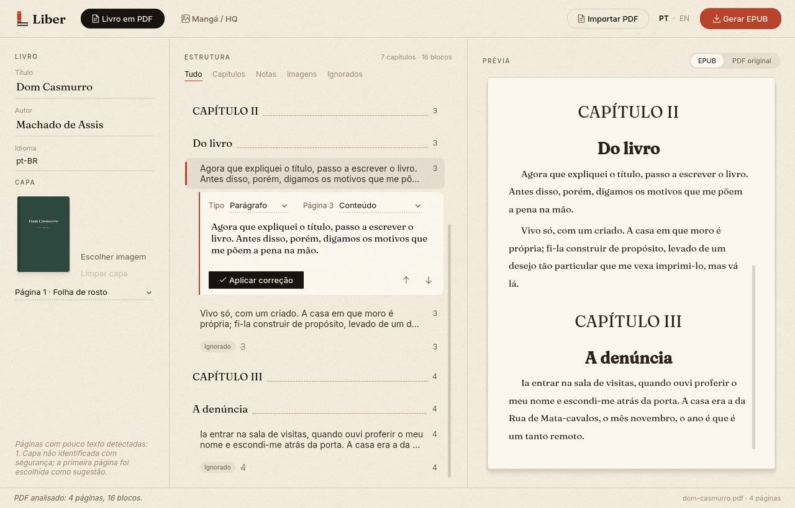
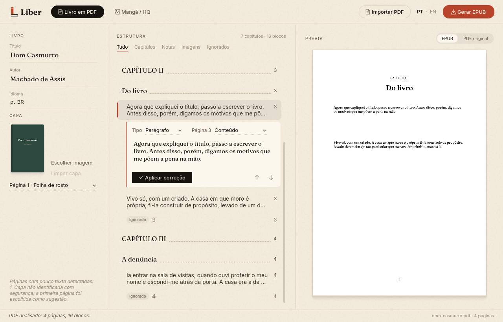

<p align="center">
  
</p>

<h1 align="center">Liber</h1>

<p align="center">
  <strong>Converta PDF, mangá e HQ em EPUB.</strong><br>
  Revise capítulos, capa e ordem das páginas antes de gerar o arquivo. Tudo no seu computador.
</p>

<p align="center">
  <a href="https://github.com/k3v1nn/liber/releases"></a>
  
  <a href="LICENSE"></a>
</p>

<p align="center">
  <a href="#baixar">Baixar</a> ·
  <a href="#como-usar">Como usar</a> ·
  <a href="#executar-a-partir-do-código">Código</a> ·
  <a href="#english">English</a>
</p>

<p align="center">
  
</p>

*Liber* é “livro” em latim, e também “livre”. O aplicativo transforma PDFs em EPUBs de texto fluido e páginas de mangá ou HQ em EPUBs de layout fixo, com uma etapa de revisão no meio. Nenhum arquivo é enviado para a internet.

## Recursos

**Livro em PDF → EPUB de texto fluido**

- Detecta capítulos, títulos, imagens, notas, possíveis capas e páginas iniciais.
- Remove cabeçalhos, rodapés e números de página repetidos.
- Faz OCR em português e inglês nas páginas escaneadas, quando o Tesseract está instalado no sistema.
- Mostra a estrutura como um sumário: clique num bloco para corrigir o texto, mudar o tipo do bloco ou da página e reordenar.
- Compara a prévia do EPUB com a página original do PDF.
- Usa como capa uma página do PDF ou uma imagem sua.



**Mangá / HQ → EPUB de layout fixo**

- Importa imagens, uma pasta inteira (em ordem natural: 2 antes de 10), um PDF de HQ ou as imagens visíveis de uma URL pública.
- Reordena as páginas arrastando as miniaturas.
- Marca a capa (★) e o início de cada capítulo (fita vermelha).
- Lê da direita para a esquerda ou da esquerda para a direita.
- Respeita a rotação e o espelhamento EXIF das fotos.


**Interface**

- A tela inicial mostra os últimos EPUBs gerados numa estante. Clique num livro para abrir a pasta dele.
- Arraste um PDF, imagens ou uma pasta para qualquer ponto da janela.
- O layout se adapta a janelas estreitas, e a interface está em português e inglês.

<table>
  <tr>
    <td width="50%"></td>
    <td width="50%"></td>
  </tr>
  <tr>
    <td align="center"><sub>Página original do PDF ao lado da estrutura</sub></td>
    <td align="center"><sub>Janela estreita: os dados do livro passam para o topo</sub></td>
  </tr>
</table>

## Baixar

Os executáveis ficam em **[Releases](https://github.com/k3v1nn/liber/releases)**. Baixe só o ZIP do seu sistema e extraia antes de abrir:

| Sistema | Arquivo | Abrir |
| --- | --- | --- |
| Windows 64 bits | `ConversorEPUB-windows-x64.zip` | `ConversorEPUB.exe` |
| macOS com chip Apple (M1 ou posterior) | `ConversorEPUB-macos-arm64.zip` | `ConversorEPUB.app` |
| macOS Intel | `ConversorEPUB-macos-x64.zip` | `ConversorEPUB.app` |
| Linux 64 bits | `ConversorEPUB-linux-x64.zip` | `ConversorEPUB` |

Não é preciso instalar Python. Cada ZIP inclui a licença e o código-fonte correspondente.

Os aplicativos ainda não têm assinatura digital:

- **macOS:** se a primeira abertura for bloqueada, tente abrir o app e depois acesse **Ajustes do Sistema → Privacidade e Segurança → Abrir Mesmo Assim**.
- **Windows:** se aparecer o aviso do SmartScreen, confira a origem do arquivo e escolha **Mais informações → Executar assim mesmo**.
- **Linux:** o executável gerado em distribuições recentes pode exigir uma versão igualmente recente da glibc.

## Como usar

### Livro em PDF

1. Clique em **Livro em PDF** e importe o arquivo, ou arraste o PDF para a janela.
2. Revise a **Estrutura**. Ao selecionar um bloco, o editor abre logo abaixo dele: corrija o texto, troque o tipo (Capítulo, Parágrafo, Nota, Imagem, Ignorar…) e aplique. As setas reordenam blocos dentro da mesma página, e os filtros mostram só capítulos, notas, imagens ou blocos ignorados.
3. Escolha a capa: uma página do PDF ou uma imagem própria.
4. Clique em **Gerar EPUB**. O leitor de e-book controla fonte e tamanho do texto.

O sumário do EPUB usa os blocos marcados como **Capítulo**. Textos antes do primeiro capítulo ficam numa seção separada.

### Mangá / HQ

1. Clique em **Mangá / HQ** e adicione as páginas por **Imagens**, **Pasta**, **PDF de HQ** ou **URL pública**. Cada página de um PDF de HQ vira uma imagem, na ordem original.
2. Arraste as miniaturas para reordenar, marque a capa e os inícios de capítulo.
3. Defina a direção de leitura e clique em **Gerar EPUB**.

Na importação por URL, os caminhos relativos das imagens são resolvidos a partir do endereço final da página, inclusive após redirecionamentos. Sites que montam as imagens com JavaScript, exigem login ou oferecem só miniaturas podem precisar de arquivos baixados manualmente. O importador não contorna essas restrições. Confira se você tem autorização para baixar e reutilizar o conteúdo.

### Privacidade

PDFs e imagens são processados localmente. O único acesso à rede é a importação por URL, quando você pede para baixar as imagens de uma página. Os arquivos originais nunca são modificados.

## Executar a partir do código

Requer Python 3.10 ou superior:

```bash
python3 -m venv .venv
.venv/bin/python -m pip install -r requirements.txt
.venv/bin/python -m conversor
```

No Windows, use `.venv\Scripts\python.exe` no lugar de `.venv/bin/python`.

### Gerar executáveis

```bash
.venv/bin/python -m pip install 'pyinstaller>=6.15,<7'
.venv/bin/python build.py
```

O pacote fica em `release/`, com o aplicativo, a licença e `codigo-fonte.zip`. O PyInstaller só gera executáveis para o sistema em que roda, por isso o [workflow de build](.github/workflows/build.yml) monta as versões de Linux x64, Windows x64 e macOS (Intel e Apple Silicon). Ele roda manualmente ou ao publicar uma tag `v*`.

### Desenvolvimento

| Arquivo | Conteúdo |
| --- | --- |
| `conversor/pdf_analysis.py` | Análise do PDF, classificação de blocos e OCR |
| `conversor/epub_export.py` | Geração dos EPUBs de texto fluido e de layout fixo |
| `conversor/gui.py` | Comportamento da janela |
| `conversor/ui_layout.py` | Montagem das telas |
| `conversor/widgets.py` | Componentes desenhados: estante, sumário, miniaturas, layout responsivo |
| `conversor/appearance.py` | Cores, fontes, ícones, logo, textura de papel e estilo |

```bash
.venv/bin/python -m unittest discover -s tests -v
```

Os testes de interface usam o Qt em modo `offscreen` e um arquivo de configuração temporário. Eles não abrem janelas nem alteram as preferências de quem roda os testes.

A análise de PDF é uma heurística, corrigível na interface. Tabelas complexas, notas com referências cruzadas e tipografia detalhada ainda precisam de tratamento próprio. Testes com PDFs reais (livro digital, escaneado, duas colunas, ilustrado) ajudam a calibrar a detecção.

## Licença

O código é distribuído sob a [GNU Affero General Public License, versão 3](LICENSE) (`AGPL-3.0-only`). Você pode usar, estudar, modificar e redistribuir o aplicativo, inclusive comercialmente, desde que siga os termos da licença. Versões modificadas distribuídas, e certas formas de disponibilização pela rede, exigem acesso ao código-fonte correspondente.

- Os modelos de OCR `por.traineddata` e `eng.traineddata` vêm do [tessdata_fast](https://github.com/tesseract-ocr/tessdata_fast), sob Apache-2.0 (`resources/tessdata/LICENSE`).
- As fontes Fraunces e Inter estão em `assets/fonts`, sob a SIL Open Font License 1.1 (`Fraunces-OFL.txt` e `Inter-OFL.txt`).
- As demais bibliotecas de `requirements.txt` mantêm suas próprias licenças.

Os EPUBs criados não recebem a licença do código. Os direitos sobre textos e imagens continuam sujeitos às licenças e autorizações do material de origem.

## English

**Liber** turns PDF books into reflowable EPUBs and manga or comic pages into fixed-layout EPUBs, with a review step in between. Everything runs locally.

- **PDF books:** chapter, heading, image and note detection; removal of repeated headers and page numbers; Portuguese and English OCR for scanned pages; inline editing of every block; EPUB and original-page preview; cover from a page or your own image.
- **Comics and manga:** import images, folders, comic PDFs or a public gallery URL; drag to reorder; cover and chapter markers; right-to-left reading.
- **Interface:** an opening shelf with your recent EPUBs, drag and drop, a responsive layout and a Portuguese/English switch.

Download the ZIP for your system from [Releases](https://github.com/k3v1nn/liber/releases), or run from source with Python 3.10+ (see above). Licensed under AGPL-3.0.
